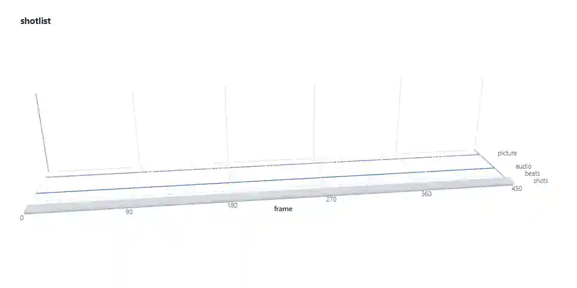

# shotlist

Shot list and Remotion template from a short video.



<sub>From `samples/test-clip.shotlist.json`, checked against the script that generated the clip. One synthetic test clip; no real video has been tested.</sub>

<picture>
  <source media="(max-width: 600px) and (prefers-color-scheme: dark)" srcset=".github/assets/rule-mobile-01-dark.svg">
  <source media="(max-width: 600px)" srcset=".github/assets/rule-mobile-01-light.svg">
  <source media="(prefers-color-scheme: dark)" srcset=".github/assets/rule-01-dark.svg">
  
</picture>

shotlist measures the edit of a short video: where every cut falls, where the beats are, and how long
each shot runs. It writes that to one file, `shotlist.json`. It then turns the file into a
[Remotion](https://remotion.dev) project with one `<Sequence>` per shot, at the same frame and length
as the source, and an empty slot for your own footage.

It is a prototype, version 0.1.0. It has been run on one synthetic test clip. No real video has been
analysed, and the optional Claude step has not been run end to end.

<picture>
  <source media="(max-width: 600px) and (prefers-color-scheme: dark)" srcset=".github/assets/rule-mobile-02-dark.svg">
  <source media="(max-width: 600px)" srcset=".github/assets/rule-mobile-02-light.svg">
  <source media="(prefers-color-scheme: dark)" srcset=".github/assets/rule-02-dark.svg">
  
</picture>

**The problem.** You can feel that an ad, a short or a trailer works. Seeing why means scrubbing frame
by frame with a notepad: where the cuts are, which ones land on the beat, how long the opening runs
before the second shot.

**What was missing.** A tool that writes those measurements down in a fixed format and hands them to a
video framework as a starting point. The timing of the edit is kept. The content is yours.

**Who it is for.** Editors and developers who build videos in Remotion and want to reuse the pacing of
a reference video with their own material. Use it on videos you have the right to analyse. The template
copies structure, never footage.

<picture>
  <source media="(max-width: 600px) and (prefers-color-scheme: dark)" srcset=".github/assets/rule-mobile-03-dark.svg">
  <source media="(max-width: 600px)" srcset=".github/assets/rule-mobile-03-light.svg">
  <source media="(prefers-color-scheme: dark)" srcset=".github/assets/rule-03-dark.svg">
  
</picture>

1. **Probe.** `ffprobe` reads frame rate, frame count, size and codecs. Frame numbers are computed from
   the average frame rate, so a constant frame rate is assumed.
2. **Cuts.** `ffmpeg` scores every frame for scene change (`select=gt(scene,T)`, T defaults to 0.3).
   Each frame above the threshold starts a new shot. Cuts closer than 6 frames to the previous one, or
   to the end, are dropped.
3. **Beats.** The audio is decoded to mono 22 050 Hz. The code computes an energy envelope, picks
   onsets where the energy rises sharply, and estimates a tempo between 60 and 180 BPM by
   autocorrelation. A cut counts as on the beat when it is within 2 frames of an onset.
4. **Pacing and colour.** Shot lengths, cuts per minute, the share of cuts on the beat, and whether
   shots get shorter or longer over the video. One frame from the middle of each shot gives its average
   colour.
5. **Structure.** With Claude credentials, one JPEG per shot (at most 60) and the measured numbers go
   to Claude, which returns a role, label and slot hint per shot, the hook device and a summary. Without
   credentials, or with `--no-llm`, roles are guessed from shot position. The timings are the same
   either way.
6. **Write.** The result is validated against the JSON Schema and written as `shotlist.json`.
7. **Export.** `shotlist export` copies a Remotion scaffold and generates `Main.tsx` with one
   `<Sequence>` per shot, and `slots.tsx`, where each slot is filled with a placeholder, a video, an
   image, text or a React component.

<picture>
  <source media="(max-width: 600px) and (prefers-color-scheme: dark)" srcset=".github/assets/rule-mobile-04-dark.svg">
  <source media="(max-width: 600px)" srcset=".github/assets/rule-mobile-04-light.svg">
  <source media="(prefers-color-scheme: dark)" srcset=".github/assets/rule-04-dark.svg">
  
</picture>

What the code does today.

- **CLI.** `shotlist analyze`, `export` and `validate`, built on commander. `cli/src/index.ts`
- **Cut detection.** ffmpeg scene score with a tunable threshold and minimum shot length. `cli/src/media.ts`
- **Beat map.** Hand-written onset detection, tempo estimate and a loudness value per frame. `cli/src/beats.ts`
- **Captions.** Timing from an SRT or VTT file, or on-screen text read by Claude and timed to its shot.
  `cli/src/captions.ts`, `cli/src/structure.ts`
- **Structure.** Claude reading with structured JSON output, plus a position-based fallback.
  `cli/src/structure.ts`
- **Schema.** JSON Schema 2020-12, TypeScript types and an ajv validator. `schema/`
- **Template export.** Remotion 4.0.543 project, one `<Sequence>` per shot. `template/`
- **Examples.** The raw export of the test clip, and the same export with every slot filled by a
  component for a made-up coffee brand. `examples/test-clip-template`, `examples/reskinned-template`

Result on the bundled test clip (`samples/test-clip.mp4`, 15 s of ffmpeg test patterns with a 120 BPM
pulse, made by [`scripts/make-test-clip.mjs`](scripts/make-test-clip.mjs) with cuts at known frames):

| Measure | Result |
|---|---|
| Shots found | 9 of 9, at the frames the generator script used |
| Tempo | about 120.2 BPM |
| Cuts on the beat | 6 of 8. The two cuts placed off the beat on purpose (3.8 s, 6.3 s) are marked off beat |
| Real videos analysed | 0 |

Known limits, from the code and the repository's own notes:

- Hard cuts only. Dissolves, wipes and whip pans can be missed. Fast motion and flashes can register
  as cuts.
- The beat map marks sudden rises in loudness. It does not track downbeats or soft melodic music, and
  the tempo is an estimate.
- Claude sees one still frame per shot. It does not see motion or hear the audio.
- There are no automated tests and no CI.
- The template carries timing only. Transitions, camera moves, colour and sound design of the source
  are not reproduced.

<picture>
  <source media="(max-width: 600px) and (prefers-color-scheme: dark)" srcset=".github/assets/rule-mobile-05-dark.svg">
  <source media="(max-width: 600px)" srcset=".github/assets/rule-mobile-05-light.svg">
  <source media="(prefers-color-scheme: dark)" srcset=".github/assets/rule-05-dark.svg">
  
</picture>

Requires Node 22 or newer and `ffmpeg` plus `ffprobe` on your `PATH`. The commands below were run on
Windows 11 with Node 26.13, npm 11.20 and ffmpeg 9.0.2, in a fresh clone. macOS and Linux were not
tested.

Install only the three packages the CLI needs. This skips the tutorial and example workspaces, which
pull in Remotion.

```bash
git clone https://github.com/hesselb20-ctrl/shotlist.git
cd shotlist
npm install -w schema -w template -w cli
npm run build
```

Analyse the bundled test clip without Claude. Expect `9 shots, avg 1.67s, 75% of cuts on the beat,
~120.2 BPM, structure by heuristic`. The `shotlist.json` it writes is byte for byte the committed
[`samples/test-clip.shotlist.json`](samples/test-clip.shotlist.json).

```bash
node cli/dist/index.js analyze samples/test-clip.mp4 --no-llm
```

Check the file against the schema. Expect `valid`.

```bash
node cli/dist/index.js validate shotlist.json
```

Export it as a Remotion project. Expect `wrote 16 files to ../my-template`. Apart from the package
name, the output matches [`examples/test-clip-template`](examples/test-clip-template).

```bash
node cli/dist/index.js export shotlist.json -o ../my-template
```

Not run here: installing, previewing or rendering the exported project (`npm install`, `npm run dev`,
`npm run render` inside it), and `analyze` with Claude credentials set (`ANTHROPIC_API_KEY`). Without
credentials, `analyze` prints a note and continues as if `--no-llm` was passed. All options are listed
by `node cli/dist/index.js analyze --help`.

<picture>
  <source media="(max-width: 600px) and (prefers-color-scheme: dark)" srcset=".github/assets/rule-mobile-06-dark.svg">
  <source media="(max-width: 600px)" srcset=".github/assets/rule-mobile-06-light.svg">
  <source media="(prefers-color-scheme: dark)" srcset=".github/assets/rule-06-dark.svg">
  
</picture>

**Stack**

| Layer | Built with |
|---|---|
| CLI | TypeScript, Node 22+, commander, npm workspaces |
| Media | ffmpeg and ffprobe, called as child processes |
| Structure step | Anthropic SDK, default model `claude-fable-5-2` |
| Schema | JSON Schema 2020-12, ajv |
| Exported template | Remotion 4.0.543, React 19 |

**Status**

| Part | State |
|---|---|
| Probe, cuts, beats, pacing | Built. Run on one synthetic clip only. |
| Claude structure step | Built. Never run end to end in this repository. |
| Heuristic fallback | Built. Produced the committed sample. |
| Template export | Built. Output matches the committed example. Rendering it was not run here. |
| Tests and CI | None. |
| npm package | Not published. |

**Roadmap.** From the repository's previous README:

1. An MCP server exposing `analyze` and `export` as tools. It does not exist yet.
2. Dissolve and fade detection.
3. Speech-to-text captions with word-level timing.
4. Downbeat tracking and bar-aware cut statistics.
5. Several frames per shot for the Claude step, so it can read motion.
6. A compare mode: several videos in, the pacing patterns they share out.
7. Publish to npm.

**Documents**

| File | Contents |
|---|---|
| [`schema/shotlist.schema.json`](schema/shotlist.schema.json) | The file format. Frames are zero-based; ranges are `[startFrame, endFrame)` |
| [`schema/example.shotlist.json`](schema/example.shotlist.json) | A full example file |
| [`examples/reskinned-template/README.md`](examples/reskinned-template/README.md) | How to fill the slots of an exported project |
| [`tutorial/`](tutorial) | Remotion project that renders the tutorial video |
| [`media/tutorial.mp4`](media/tutorial.mp4?raw=true) | 74-second tutorial video, 1920x1080, 8 MB download |

<picture>
  <source media="(max-width: 600px) and (prefers-color-scheme: dark)" srcset=".github/assets/rule-mobile-07-dark.svg">
  <source media="(max-width: 600px)" srcset=".github/assets/rule-mobile-07-light.svg">
  <source media="(prefers-color-scheme: dark)" srcset=".github/assets/rule-07-dark.svg">
  
</picture>

MIT. See [`LICENSE`](LICENSE).

Remotion, which the exported projects depend on, has [its own licence](https://remotion.dev/license).
The test clip is synthesised by ffmpeg and contains no third-party material.
