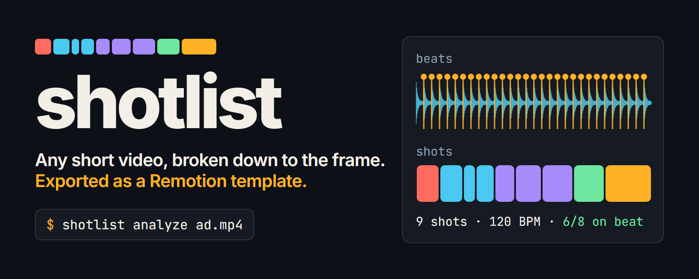
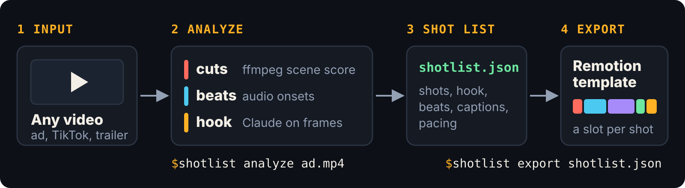
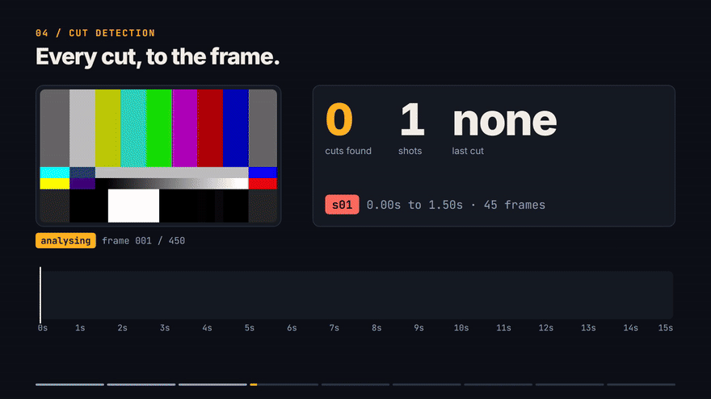
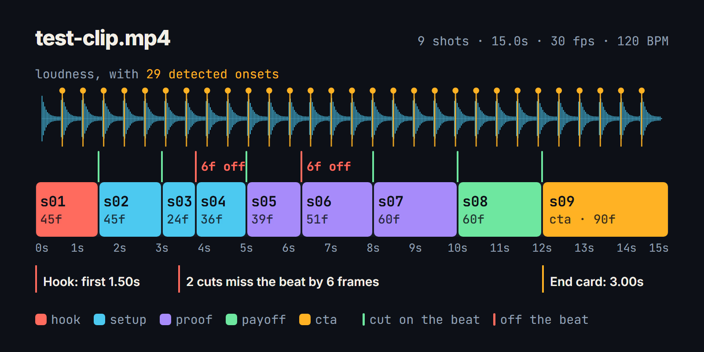
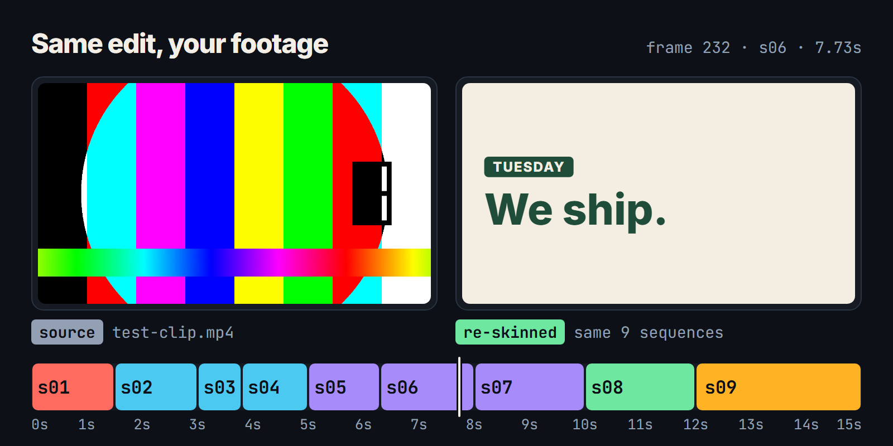

# shotlist

**Any short video, broken down to the frame. Exported as a Remotion template.**



## Why

You can feel that an ad, a TikTok or a trailer works. Seeing why means scrubbing frame by frame with a notepad: where the cuts are, which ones land on the beat, how long the hook runs before the second shot.

shotlist measures that for you and writes it to one file, `shotlist.json`. Then it turns that file into a [Remotion](https://remotion.dev) project where every shot of the source is a `<Sequence>` with the same start frame and length, and an empty slot for your own footage. The edit is kept. The content is yours.

## How it works



| Step | Tool | What it produces |
|---|---|---|
| Metadata | `ffprobe` | Frame rate, frame count, size, codecs |
| Cuts | `ffmpeg` scene score | The first frame of every shot |
| Beat map | Onset detection on the decoded audio | Onsets, a tempo estimate, a loudness envelope per frame |
| Hook and structure | Claude (`claude-fable-5-2`) on one sampled frame per shot | Role, label and slot hint per shot, the hook device, why it works |
| Template | `shotlist export` | A Remotion project with one `<Sequence>` per shot |

Everything except the Claude step runs locally. Without an API key (or with `--no-llm`) the timings are identical and only the roles and labels become position-based guesses.

## Install

Requirements: Node 22 or newer, and `ffmpeg` plus `ffprobe` on your `PATH`.

```bash
git clone https://github.com/hesselb20-ctrl/shotlist
cd shotlist
npm install
npm run build
```

For the structure analysis, set a Claude API key:

```bash
export ANTHROPIC_API_KEY=sk-ant-...
```

## Quickstart

Three commands, run from the repo root. The first uses the bundled test clip; point it at any video ffmpeg can read.

```bash
npx shotlist analyze samples/test-clip.mp4
```

```bash
npx shotlist export shotlist.json -o ../my-template
```

```bash
cd ../my-template && npm install && npm run dev
```

`analyze` prints the shot table and writes `shotlist.json`. This is the output without an API key:

```
probe    1280x720, 30 fps, 450 frames (15s)
cuts     8 cuts, 9 shots
beats    29 onsets, about 120.2 BPM
claude   skipped (--no-llm): roles and labels are guessed from shot position
wrote    shotlist.json

  s01  0.00-1.50s    45f  hook
  s02  1.50-3.00s    45f  setup   on beat
  s03  3.00-3.80s    24f  setup   on beat
  s04  3.80-5.00s    36f  setup   off beat
  ...
  9 shots, avg 1.67s, 75% of cuts on the beat, ~120.2 BPM, structure by heuristic
```

`npm run dev` opens Remotion Studio on the generated project. Fill the slots in `src/slots.tsx`, then `npm run render`.

### Options

| Command | Option | Meaning |
|---|---|---|
| `analyze <video>` | `-o, --out <file>` | Output path, default `shotlist.json` |
| | `-t, --threshold <score>` | Scene score (0 to 1) that counts as a cut, default `0.3`. Lower finds more cuts |
| | `--min-shot <frames>` | Shortest shot to keep, default `6` |
| | `--captions <file>` | Take caption timing from an SRT or VTT file |
| | `--model <id>` | Claude model, default `claude-fable-5-2` |
| | `--no-llm` | Skip Claude and guess roles from shot position |
| | `--frames-dir <dir>` | Also save the frames that were sent to Claude |
| `export <shotlist>` | `-o, --out <dir>` | Directory to create, default `shotlist-template` |
| | `--name <name>` | Package name of the generated project |
| | `--force` | Write into a directory that already has files |
| `validate <shotlist>` | | Check a file against the schema |

## Tutorial

[](media/tutorial.mp4)

Click the preview for the full 74-second video ([media/tutorial.mp4](media/tutorial.mp4), 1920x1080, 30 fps). It is itself a Remotion project, in [`tutorial/`](tutorial), and every number on screen is read from the sample analysis.

## What you get

The annotated shot list of the bundled test clip. Two cuts were placed off the beat on purpose, and the analysis finds both:



The source next to the exported template with its slots filled, at the same frame:



Both versions are in the repo:

- [`examples/test-clip-template`](examples/test-clip-template) is the untouched output of `shotlist export`.
- [`examples/reskinned-template`](examples/reskinned-template) is the same export with [`slots.tsx`](examples/reskinned-template/src/slots.tsx) filled in for a made-up coffee brand. `Main.tsx` and its timings are unchanged.

### The sample

`samples/test-clip.mp4` is 15 seconds of ffmpeg test patterns with a tone and a 120 BPM pulse, generated by [`scripts/make-test-clip.mjs`](scripts/make-test-clip.mjs). It contains no third-party material. Its analysis, [`samples/test-clip.shotlist.json`](samples/test-clip.shotlist.json), was produced with `--no-llm`, so its roles and labels are the positional guesses, not Claude's reading. Test patterns have no story to read anyway.

## The schema

`shotlist.json` is described by [`schema/shotlist.schema.json`](schema/shotlist.schema.json) (JSON Schema 2020-12), with a full example in [`schema/example.shotlist.json`](schema/example.shotlist.json). TypeScript types and a validator are exported from `@shotlist/schema`.

Frame numbers are zero-based and counted at `source.fps`. Ranges are `[startFrame, endFrame)`: the end is exclusive.

| Field | Contents |
|---|---|
| `source` | File name, duration in seconds and frames, fps, size, codecs |
| `detection` | The settings used: scene threshold, minimum shot length, beat tolerance |
| `shots[]` | One entry per shot, contiguous, covering the whole video |
| `hook` | Frame range of the opening, the device it uses, a description |
| `beats` | `bpm` (or null), `onsets[]` with frame, time and strength, `envelope[]` with one loudness value per frame |
| `captions[]` | Text with a frame range. `source` is `subtitles` (from an SRT/VTT file) or `vision` (read from a frame, timed to its shot) |
| `pacing` | Shot count, average, median, shortest and longest shot, cuts per minute, share of cuts on the beat, and whether the pace is `accelerating`, `steady` or `decelerating` |
| `analysis` | `source` (`claude` or `heuristic`), the model, a summary, and `whyItWorks[]` |

A shot:

```json
{
  "id": "s04",
  "index": 3,
  "startFrame": 114,
  "endFrame": 150,
  "durationFrames": 36,
  "startSec": 3.8,
  "endSec": 5,
  "role": "setup",
  "label": "Setup shot",
  "description": "Shot 4 of 9, 1.20s. Role guessed from its position in the edit.",
  "slot": { "type": "video", "hint": "Context: the problem, the setting or the before state." },
  "cutOnBeat": false,
  "dominantColor": "#666666"
}
```

`role` is one of `hook`, `setup`, `proof`, `payoff`, `cta`, `other`. `cutOnBeat` is true when the cut into the shot is within `detection.beatToleranceFrames` (2) of an onset.

## Repo layout

| Path | What it is |
|---|---|
| [`cli/`](cli) | The `shotlist` command: `analyze`, `export`, `validate` |
| [`template/`](template) | The generator behind `export`, and the scaffold it copies |
| [`schema/`](schema) | JSON Schema, example, types and validator |
| [`tutorial/`](tutorial) | Remotion project for the tutorial video and the README images |
| [`examples/`](examples) | An exported template, raw and re-skinned |
| [`samples/`](samples) | The test clip and its analysis |
| [`media/`](media) | Rendered video, GIF and images |

To rebuild everything in `media/` except the hand-written SVG:

```bash
npm run media
```

On Windows, clone into a short path first. Remotion's headless browser does not start when its path exceeds 260 characters.

## Limitations

- **Hard cuts only.** Detection uses ffmpeg's scene score. Dissolves, wipes and whip pans can be missed, and fast motion or flashes can register as cuts. Tune `--threshold` and check the table.
- **Onsets, not bars.** The beat map marks sudden rises in loudness: drums, claps, hits. It does not track downbeats or follow soft melodic music, and the BPM is an estimate. A sound that starts on the very first frame is not marked as an onset.
- **Claude sees one frame per shot.** It does not see motion and does not hear the audio, so the hook and role analysis is a reading of stills plus the measured numbers. With more than 60 shots, frames are sampled from every nth shot.
- **The Claude step is untested end to end in this repo.** The request compiles against the SDK types and the fallback path is exercised by the sample, but the sample itself was made without an API key.
- **Captions are basic.** Timing comes from an SRT/VTT file you supply, or from on-screen text read from the sampled frame and timed to the whole shot. There is no speech-to-text.
- **Constant frame rate assumed.** Frame numbers are computed from the average frame rate. Convert variable-frame-rate phone footage first (`ffmpeg -i in.mp4 -fps_mode cfr out.mp4`).
- **Timing is all the template carries.** Transitions, camera moves, effects, colour and sound design of the source are not reproduced.
- **Use it on videos you have the right to analyse.** The template copies structure, never footage, and structure alone does not make a video yours to imitate wholesale.
- Remotion has [its own licence](https://remotion.dev/license): free for individuals and small teams, paid for larger companies.

## Roadmap

- MCP server exposing `analyze` and `export` as tools, so an agent can break down a reference video and build on the template
- Dissolve and fade detection
- Speech-to-text captions with word-level timing
- Downbeat tracking and bar-aware "cut on the 1" stats
- Several frames per shot for the Claude step, so it can read motion
- Compare mode: several videos in, the pacing patterns they share out
- Publish to npm

## License

[MIT](LICENSE)
